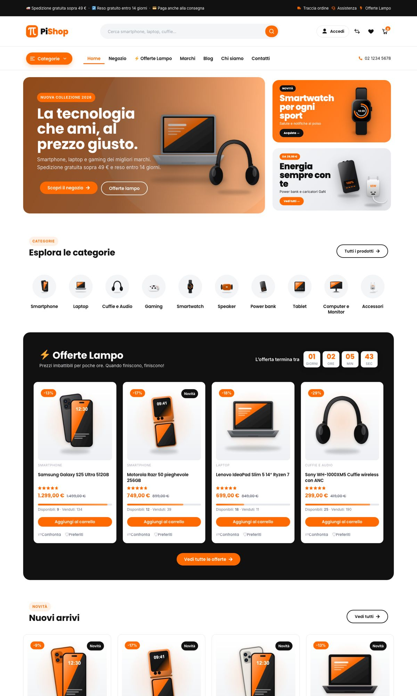
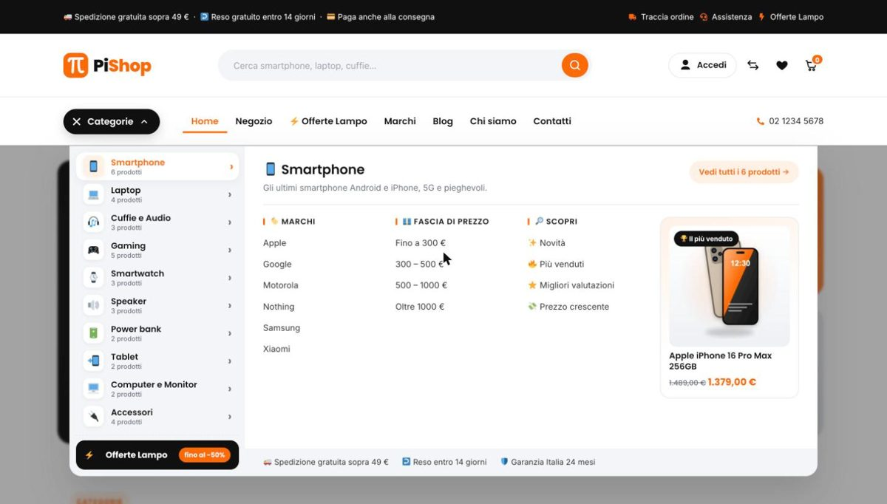
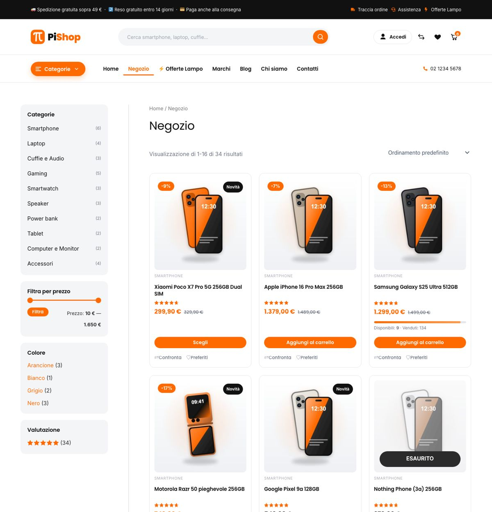
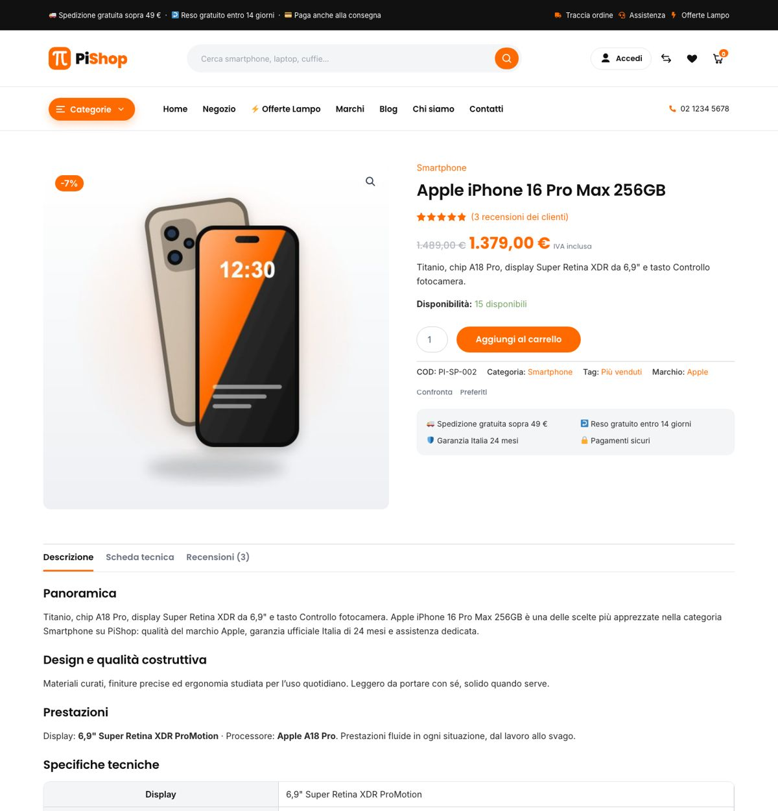
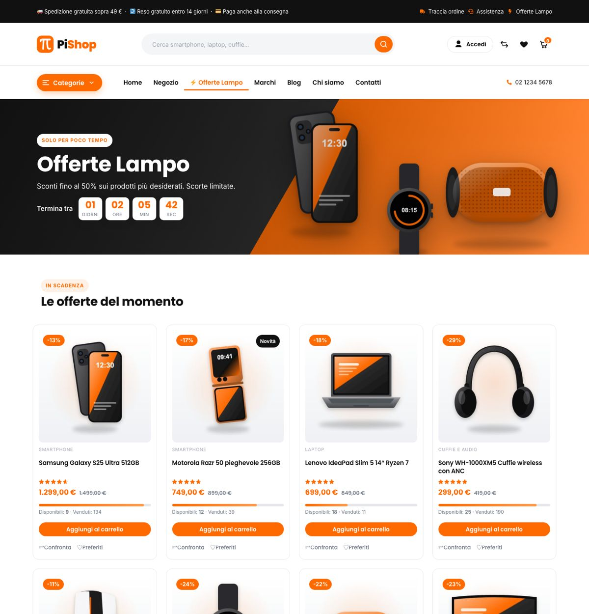
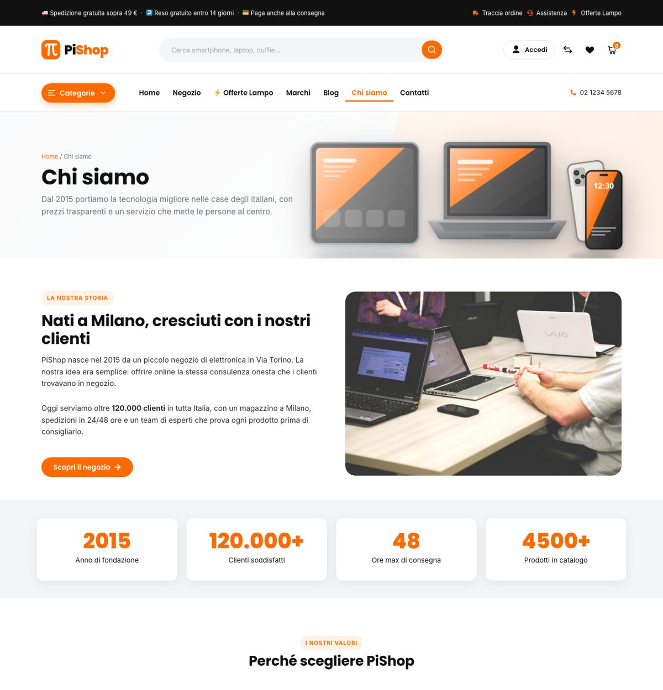
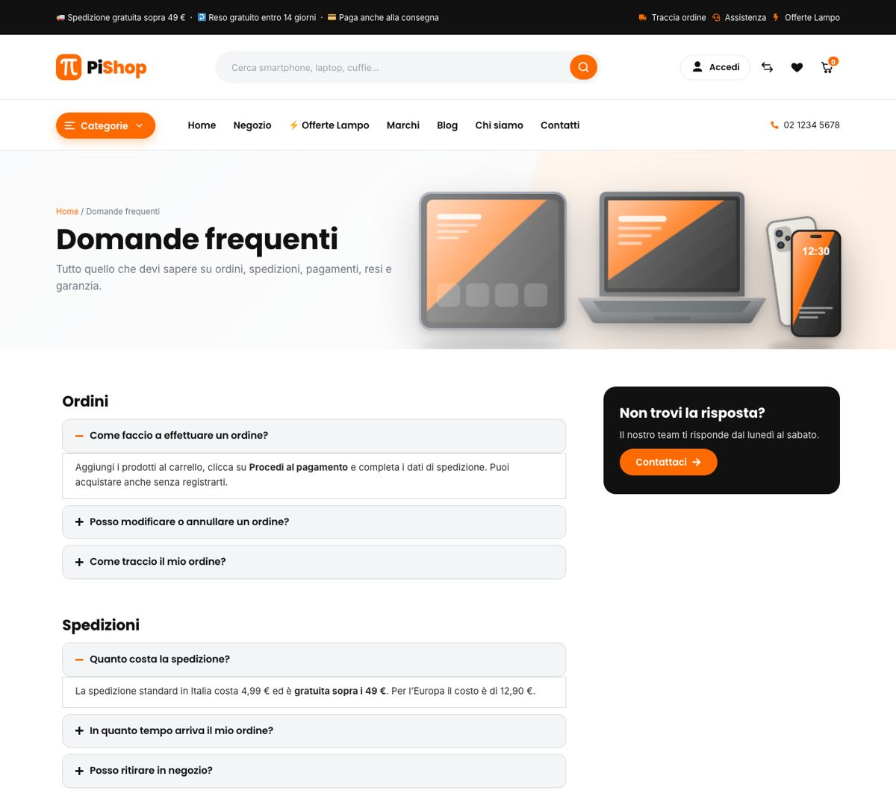
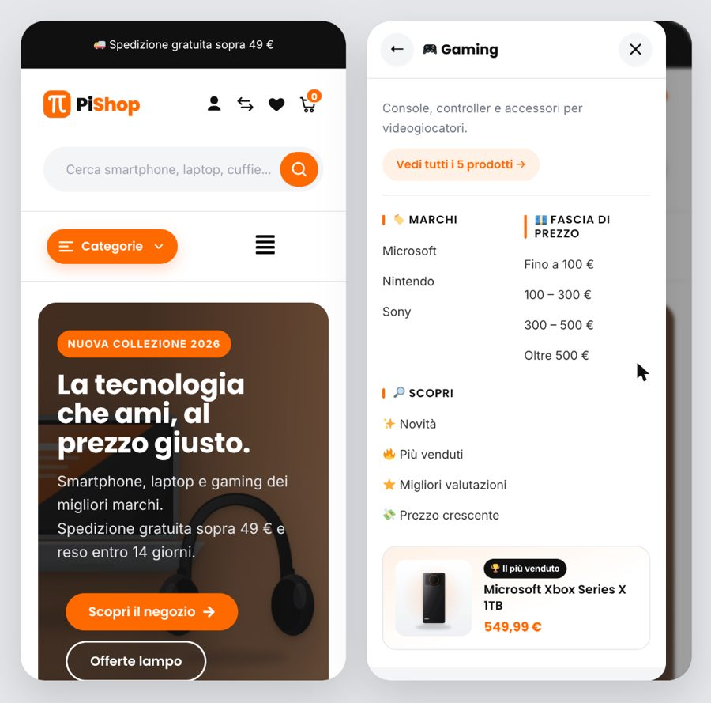

# PiShop: Italian electronics e-commerce (WordPress + WooCommerce + Elementor)

An end-to-end online shop built as a portfolio project. It's an Italian-language consumer-electronics store with an orange / black / gray / white brand, and every marketing page is built with the **Elementor page builder**.

| | |
|---|---|
| Stack | WordPress 7.1 · WooCommerce 11 · Elementor 4.4 · Astra + `pishop-child` · Header Footer Elementor · WPC Compare/Wishlist · WPForms Lite |
| Local URL | http://onlineshop.local (Local by Flywheel) |
| Catalog | 34 products in 10 categories, 14 brands, variable/simple/external/sale/out-of-stock products, reviews |
| Pages | Home, Negozio, product pages, Carrello, Cassa, Il mio account, Offerte Lampo, Chi siamo, Contatti, FAQ, Blog (+6 articles), Marchi, Confronta, Lista desideri, Traccia ordine, Spedizioni e resi, Termini, Privacy, Cookie, 404 |

See [project.md](project.md) for the full specification, [rules.md](rules.md) for the guardrails, and [steps.md](steps.md) for the progress log.

## Screenshots

| Home | Mega menu (categories) |
|---|---|
|  |  |

| Shop with filters | Product page |
|---|---|
|  |  |

| Offerte Lampo | Chi siamo |
|---|---|
|  |  |

| FAQ | Mobile: home + category drawer |
|---|---|
|  |  |

## Project timeline

Built in a single working session on **12 November 2026**. Each phase is a tagged release (see *Releases* on GitHub).

| Release | Phase | What was delivered |
|---|---|---|
| `v0.1` | Planning | Reference analysis (17 iShop pages), `project.md`, `rules.md`, `steps.md`, `.gitignore` |
| `v0.2` | Core setup | Local site + WP-CLI wrapper, Italian locale, WooCommerce for Italy (EUR, IVA 22%, shipping zones, test payments), child theme |
| `v0.3` | Catalog & pages | Product renders and banners, 34-product catalog, Elementor build pipeline, header/footer, 14 pages, blog |
| `v0.4` | QA | Card layout, sale badges, shop filters, mobile header, free-shipping logic, end-to-end checkout test, `setup.sh` |
| `v0.5` | Mega menu | iShop-style category mega menu with emojis, filtered links, best-seller cards, mobile drill-down drawer |
| `v1.0` | Release | Hardened `.gitignore`, screenshots, timeline, mobile header polish |

The detailed step-by-step log is in [steps.md](steps.md).

## How it's built
Everything is **reproducible from scripts**. Nothing was configured by hand in wp-admin.

```
scripts/setup.sh            # one command: plugins → settings → images → catalog → pages
├─ 01-core.sh               # language, permalinks, WooCommerce IT settings (EUR, IVA 22%, shipping, payments)
├─ render_products.py       # original SVG product renders → PNG/JPG via headless Chrome
├─ make_banners.py          # logo, hero slides, promo banners (brand palette)
├─ import-catalog.php       # categories, brands, attributes, products, variations, reviews
├─ import-media.php         # banners/photos into the media library (hash-aware refresh)
├─ build_pages.py           # generates Elementor JSON (containers + core widgets, Global Colors)
└─ apply-pages.php          # Elementor kit, WPForms, blog posts, pages, header/footer, menus, Astra
```

- **Page builder:** each page is a normal Elementor document. Open it in *Modifica con Elementor* to edit it visually. Header and footer are Elementor templates (Header Footer Elementor).
- **Design system:** Elementor Global Colors/Fonts (Poppins + Inter) plus `theme/pishop-child/assets/css/pishop.css`.
- **Dynamic parts** are child-theme shortcodes placed in Elementor *Shortcode* widgets: countdown, flash deals with stock bar, brand list, latest posts, header icons with live cart count.
- **Images:** product renders and banners are original artwork. The lifestyle photos are CC0/CC-BY, credited in [assets/CREDITS.md](assets/CREDITS.md).

## Run locally
1. Install Local and create a site called `onlineshop` (PHP 8.2).
2. Adjust the `SITE_ID` in `bin/wp` if yours differs (see `~/Library/Application Support/Local/sites.json`).
3. `scripts/setup.sh`

> **macOS 27 note:** Local's PHP-FPM aborts on outbound HTTPS from web requests (an `objc … fork()` crash). The local `wp-config.php` sets `WP_HTTP_BLOCK_EXTERNAL` for web requests only, so WP-CLI keeps network access. Updates and plugins are installed via `bin/wp`.

## Test checkout
Payments are test-only: *Bonifico bancario* and *Contrassegno*. Shipping costs €4.99 and is free above €49; IVA 22% is included.
